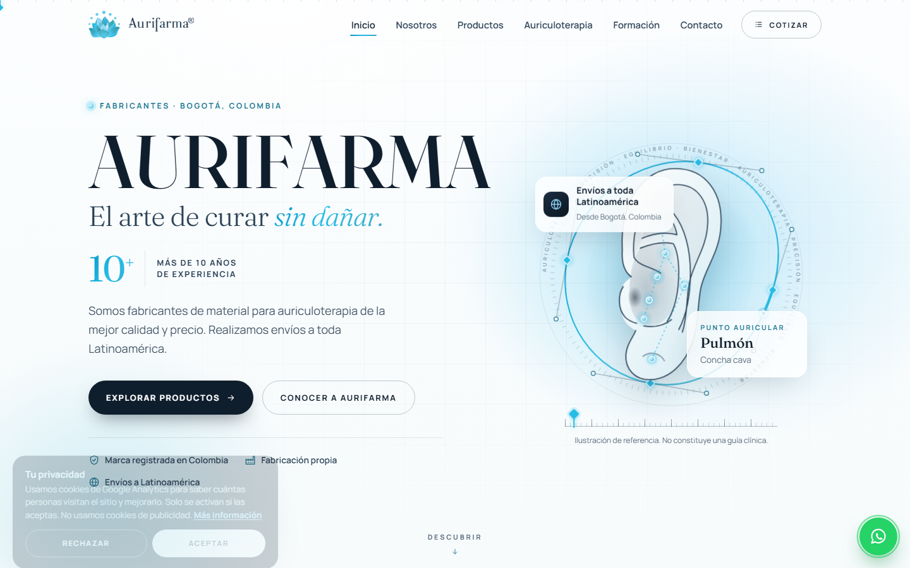

# Aurifarma · Auriculotherapy supplies manufacturer

Corporate website and catalog for a Colombian manufacturer of professional auriculotherapy supplies.

**[🔗 Live demo](https://www.aurifarma.com)** · [🇪🇸 Leer en español](#-español)

   



## ✨ Highlights

- Product catalog with professional product photography
- Contact/order form connected to Google Sheets through Apps Script
- Custom 404, favicons and SEO metadata
- Live on its own domain

## 🚀 Run locally

No build step. Open `index.html` in a browser, or serve the folder:

```bash
npx serve .
```

## 👤 Author

Designed and developed by **Sneyder Riaño**, graphic designer & web developer in Bogotá, Colombia.
[Portfolio](https://sneyder.netlify.app) · [GitHub](https://github.com/artsneyderdiseno-droid)

> Brand names, logos and photos belong to their respective owners and are shown with permission as portfolio work. The code is shared for review purposes; please don't reuse brand assets.

---

## 🇪🇸 Español

Web corporativa y catálogo para un fabricante colombiano de material profesional de auriculoterapia.

**[Ver en vivo](https://www.aurifarma.com)**

**Lo más destacado**

- Catálogo con fotografía profesional de producto
- Formulario de contacto/pedido conectado a Google Sheets con Apps Script
- 404 propia, favicons y metadatos SEO
- Publicada en dominio propio

**Cómo ejecutarlo**

Sin compilación. Abre `index.html` en el navegador o sirve la carpeta con `npx serve .`

Diseño y desarrollo: **Sneyder Riaño** · Bogotá, Colombia.
